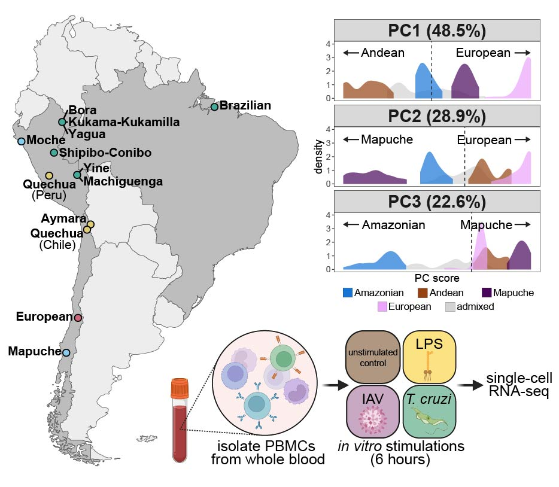

# Genetic ancestry shapes context-dependent immune regulation across Indigenous South American populations

This repository contains the code necessary to reproduce the analyses published in:

> Choy C\*, Vicuña L\*, et al. Genetic ancestry shapes context-dependent immune regulation across Indigenous South American populations. *medRxiv* (2026).

## Overview

Here, we generated a single-cell transcriptional atlas of 1.4 million peripheral blood mononuclear cells from 345 individuals representing 12 Indigenous populations from Brazil, Chile, and Peru and one European-ancestry comparison group living in Chile. Cells were profiled at baseline and following stimulation with bacterial lipopolysaccharide (LPS), influenza A virus, and the protozoan parasite *Trypanosoma cruzi*. We show that genetic ancestry contributes broadly to context-dependent immune gene expression in Indigenous South American populations and that these differences in gene expression are substantially explained by local regulatory variants, many of which are rare in European datasets and colocalize with GWAS loci for immune-related traits.

  

## Repository structure

Scripts are organized into the following directories, roughly in the order they should be run. Each directory contains its own detailed README describing the inputs, outputs, and order of scripts.

1. **`01_single-cell_preprocessing/`**: Read alignment, genetic demultiplexing, cell QC and annotation, pseudobulk generation, and capture-corrected gene expression matrix.
2. **`02_genotyping_and_ancestry/`**: Genotype quality control, imputation, and estimation of global genetic ancestry.
3. **`03_immune_response/`**: Differential expression analyses characterizing transcriptional responses to each immune stimulus.
4. **`04_ancestry_effects/`**: Analyses related to ancestry-associated gene expression and how these effects vary across immune contexts.
5. **`05_eQTL_mapping/`**: Mapping of expression QTL and response eQTL across conditions.
6. **`06_global_ancestry_PVE/`**: Quantifying the genetic contribution of eQTLs to variation in ancestry-associated gene expression.
7. **`07_colocalization/`**: Analyses related to colocalization of eQTL and GWAS signals.
8. **`figures/`**: Scripts that generate the main and supplementary figures from the outputs of the directories above.

## Data availability

Raw scRNA-seq sequencing data are available at the NCBI Gene Expression Omnibus (GEO) under accession GSE351087.

Raw genotype sequencing data are available at the European Genome-phenome Archive (EGA) under accession [XXXXX].

Processed data (i.e., metadata, gene expression matrices) needed to run the downstream main analyses are available on Zenodo (https://doi.org/10.5281/zenodo.23425836). Please see the [`data/` README](https://github.com/choyc2/south-american-innate-immunity/tree/main/data) for more detailed instructions.
